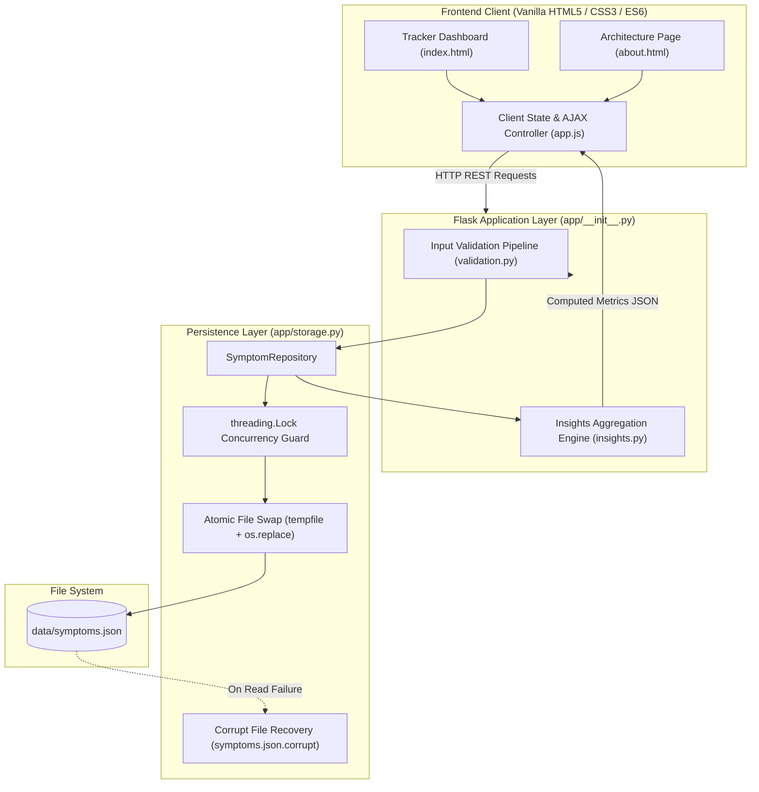

# 🩺 HealthTrack — Patient Symptom Tracker

<p align="center">
  
  
  
  
  
</p>

<p align="center">
  <strong>A resilient, modern health application designed for patients to log daily symptoms, track longitudinal patterns, and generate weekly clinical insights.</strong>
</p>

<p align="center">
  Built with precision for the <strong>Aiden AI Take-Home Assessment</strong> (Python · AIML · GenAI).
</p>

---

## 👨‍💻 Candidate Information

| Profile | Link |
|:---|:---|
| **Author** | **Vijay Rajesh R** |
| **GitHub** | [github.com/vijayrajeshr](https://github.com/vijayrajeshr) |
| **LinkedIn** | [linkedin.com/in/vijayrajeshr](https://www.linkedin.com/in/vijayrajeshr) |
| **Portfolio** | [vijayrajeshr.vercel.app](https://vijayrajeshr.vercel.app/) |

---

## 📑 Table of Contents

- [Requirements Coverage Matrix](#-requirements-coverage-matrix)
- [Key Features](#-key-features)
- [System Architecture](#-system-architecture)
- [Quickstart & Setup](#-quickstart--setup)
- [API Specification](#-api-specification)
- [Project Structure](#-project-structure)
- [Architectural Highlights](#-architectural-highlights)
- [Automated Test Suite](#-automated-test-suite)
- [AI Usage](#-ai-usage)

---

## 🎯 Requirements Coverage Matrix

| Category | Assessment Requirement | Implementation Status | Core Module |
|:---:|---|:---:|---|
| **Must** | Log symptoms with severity (1–10) & date with thorough input validation | ✅ **Complete** | [`POST /api/symptoms`](#post-apisymptoms), [`app/validation.py`](app/validation.py) |
| **Must** | Data model: user ID, symptom, severity, timestamp; file persistence | ✅ **Complete** | [`app/storage.py`](app/storage.py), `data/symptoms.json` |
| **Should**| Retrieve user symptoms filtered by date range | ✅ **Complete** | [`GET /api/symptoms`](#get-apisymptoms) (`?user_id=&start=&end=`) |
| **Should**| Insights: average severity per week, top symptoms, trends | ✅ **Complete** | [`GET /api/insights`](#get-apiinsights), [`app/insights.py`](app/insights.py) |
| **Must** | Robust input validation and error handling on all inputs | ✅ **Complete** | Field-level error dicts, HTTP 400/404/405/413 |
| **Could** | Simple, polished, accessible web UI using a framework | ✅ **Complete** | Flask + Jinja2 + Vanilla CSS/JS (Tracker & About) |

---

## ✨ Key Features

- **Granular Symptom Logging:** Interactive 10-point color-calibrated severity scale (`#10b981` to `#b91c1c`) with accessible radio semantics (`role="radiogroup"`), keyboard navigation, and dynamic autocomplete for previously logged symptoms.
- **Longitudinal Clinical Insights:**
  - **Weekly Averages:** Automatic ISO-8601 calendar-week grouping (Monday start) rendered with proportional severity bars.
  - **Top Symptoms:** Ranked top-5 symptom frequencies with deterministic alphabetical tie-breaking.
  - **Rolling Two-Week Trend:** Automatic evaluation comparing recent weeks ($\ge \pm 0.5$ threshold triggers `improving`, `worsening`, or `steady`).
  - **Peak Entry Identification:** Surfaces highest severity episode with latest date tie-resolution.
- **Pre-loaded Starter Dataset:** Ready with multi-week longitudinal data out of the box for instant evaluation.
- **Defensive Engineering:** Thread-safe file operations, atomic temporary file swaps, self-healing JSON corrupt recovery, request body size limits, and full Stored XSS mitigation.

---

## 🏗️ System Architecture



---

## 🚀 Quickstart & Setup

### 1. Prerequisites
- **Python 3.10+** (Tested on Python 3.11 and 3.13)
- `pip` or `uv` package manager

### 2. Installation & Run

```bash
# 1. Clone the repository
git clone https://github.com/vijayrajeshr/HealthTrack-Patient-Symptom-Tracker.git
cd HealthTrack-Patient-Symptom-Tracker

# 2. Create and activate a virtual environment
python -m venv .venv

# On Windows:
.venv\Scripts\activate
# On macOS/Linux:
source .venv/bin/activate

# 3. Install dependencies
pip install -r requirements.txt

# 4. Start the application
python run.py
```

> [!TIP]
> The application will start at **[http://127.0.0.1:5000](http://127.0.0.1:5000)**. Existing sample data is included, so the dashboard will immediately display rich charts and insights.

### 3. Demo Data Seeding (Optional)
To regenerate or extend sample symptom data across a 4-week window for any user:
```bash
python scripts/seed_demo.py demo
```

### 4. Run Automated Test Suite
Execute the comprehensive test suite with verbose reporting:
```bash
pytest -v
```
*Executes all **46 automated tests** covering validation boundaries, concurrent storage, insights calculations, and API integration.*

---

## 📡 API Specification

All endpoints return uniform JSON payloads. Validation errors return HTTP `400 Bad Request` with field-level breakdowns:

```json
{
  "error": "Some fields need fixing.",
  "details": {
    "severity": "Severity must be a whole number between 1 and 10.",
    "date": "Date cannot be in the future."
  }
}
```

### Endpoints Overview

| Method | Endpoint | Description | Success Code |
|:---:|---|---|:---:|
| `GET` | `/` | Web application symptom tracker dashboard | `200 OK` |
| `GET` | `/about` | System architecture, candidate profile & technical notes | `200 OK` |
| `POST` | `/api/symptoms` | Log a new symptom record | `201 Created` |
| `GET` | `/api/symptoms` | Retrieve filtered symptom history | `200 OK` |
| `GET` | `/api/insights` | Fetch aggregated analytics & rolling trends | `200 OK` |
| `DELETE` | `/api/symptoms/<id>` | Delete a symptom entry by ID | `204 No Content` |

<details>
<summary><strong>🔍 Click to expand API Request & Response Examples</strong></summary>

#### `POST /api/symptoms`
**Request Body:**
```json
{
  "user_id": "demo",
  "symptom": "Migraine",
  "severity": 7,
  "date": "2026-10-14"
}
```
**Response (`201 Created`):**
```json
{
  "id": "e9b21f074a12",
  "user_id": "demo",
  "symptom": "migraine",
  "severity": 7,
  "date": "2026-10-14",
  "timestamp": "2026-10-14T10:30:00.000000+00:00"
}
```

#### `GET /api/insights?user_id=demo`
**Response (`200 OK`):**
```json
{
  "total_entries": 29,
  "average_severity": 4.4,
  "weekly_averages": [
    { "week_start": "2026-09-14", "average_severity": 4.0, "entries": 6 },
    { "week_start": "2026-09-21", "average_severity": 4.0, "entries": 9 },
    { "week_start": "2026-09-28", "average_severity": 5.0, "entries": 2 },
    { "week_start": "2026-10-05", "average_severity": 3.5, "entries": 4 },
    { "week_start": "2026-10-12", "average_severity": 5.6, "entries": 8 }
  ],
  "most_common": [
    { "symptom": "brain fog", "count": 6, "average_severity": 4.0 },
    { "symptom": "fatigue", "count": 6, "average_severity": 4.0 },
    { "symptom": "lower back pain", "count": 5, "average_severity": 6.2 }
  ],
  "highest_entry": {
    "id": "abaacd3c89d4",
    "user_id": "demo",
    "symptom": "brain fog",
    "severity": 10,
    "date": "2026-10-14",
    "timestamp": "2026-10-14T04:08:47.368131+00:00"
  },
  "trend": "worsening",
  "message": null
}
```

</details>

---

## 📂 Project Structure

```text
HealthTrack-Patient-Symptom-Tracker/
├── app/
│   ├── __init__.py          # Flask app factory, route controllers, error handlers
│   ├── validation.py        # Pure functions for input validation and normalization
│   ├── storage.py           # SymptomRepository: thread locking, atomic swaps, self-healing
│   ├── insights.py          # Pure functions: ISO-week grouping, top rankings, 2-week trends
│   ├── templates/
│   │   ├── index.html       # Patient symptom tracker dashboard template
│   │   └── about.html       # Architecture overview & candidate credentials
│   └── static/
│       ├── style.css        # Responsive design, accessible 10-step severity ramp, dark palette
│       └── app.js           # Vanilla ES6 client reactivity, XSS protection, dynamic charts
├── data/
│   ├── .gitkeep             # Git directory placeholder
│   └── symptoms.json        # Pre-seeded starter persistence file
├── scripts/
│   └── seed_demo.py         # Deterministic multi-week sample generator
├── tests/
│   ├── conftest.py          # Pytest fixtures and isolated temporary directories
│   ├── test_validation.py   # Boundary tests, accept/reject matrix, type coercion checks
│   ├── test_storage.py      # Concurrency tests, atomic write integrity, recovery checks
│   ├── test_insights.py     # Aggregations, rankings, tie-breakers, 2-week trend logic
│   └── test_api.py          # End-to-end integration tests (200, 201, 204, 400, 404, 405, 413)
├── pytest.ini               # Pytest root configuration
├── requirements.txt         # Minimal dependencies (Flask >= 3.0.0, pytest >= 8.0.0)
├── run.py                   # Development entrypoint with auto-seed fallback
├── README.md                # Comprehensive project documentation
└── .gitignore               # Ignores .venv, cache, temporary files, secrets
```

---

## 🏛️ Architectural Highlights

1. **Repository Pattern (`app/storage.py`):**
   HTTP controllers never touch raw file handles or database drivers directly. Any future transition to SQLite, PostgreSQL, or DynamoDB requires changing only `SymptomRepository`, keeping domain logic and API routes untouched.
2. **Atomic Writes & Resilient Persistence:**
   Prevents file truncation and corruption during unexpected shutdowns. Writes are staged via `tempfile.NamedTemporaryFile` + `os.fsync()`, followed by an atomic filesystem replacement (`os.replace()`), guarded by a concurrency `threading.Lock()`.
3. **Self-Healing Corruption Recovery:**
   If `symptoms.json` is corrupted externally, the repository archives the damaged file as `symptoms.json.corrupt`, resets storage cleanly with an empty collection `[]`, and continues serving traffic uninterrupted.
4. **All-Errors-At-Once Validation (`app/validation.py`):**
   Instead of short-circuiting on the first bad field, the validator checks all payload attributes and returns a consolidated dictionary of field-level errors for simultaneous UI feedback.
5. **Data Normalization:**
   Symptom labels are trimmed, internal whitespaces collapsed, and text lowercased (e.g. `"  Tension   HEADACHE "` $\to$ `"tension headache"`), guaranteeing consistent metric grouping.
6. **Pure Functional Insights (`app/insights.py`):**
   - Dates are partitioned into ISO-8601 calendar weeks starting on Monday.
   - Frequency rankings resolve ties alphabetically for reproducible results.
   - Week-over-week severity changes $\ge 0.5$ compute directional health trends (`improving`, `worsening`, or `steady`).
7. **Zero-Build Vanilla Frontend:**
   High performance and accessibility without the maintenance burden of Webpack, Vite, or npm dependencies. Features dynamic autocomplete, keyboard navigation, and optimistic UI updates.
8. **Defensive Frontend Security (XSS Hardening):**
   User-generated symptom strings are bound using explicit DOM construction and `textContent` properties, supplemented by an `escapeHtml` utility, eliminating Stored Cross-Site Scripting (XSS) risks.

---

## 🧪 Automated Test Suite

HealthTrack includes **46 automated tests** providing comprehensive test coverage across the entire system:

```text
tests/test_api.py .................                                      [ 36%]
tests/test_insights.py .......                                           [ 52%]
tests/test_storage.py .........                                          [ 71%]
tests/test_validation.py .............                                   [100%]

============================= 46 passed in 0.38s ==============================
```

- **Validation Tests (`test_validation.py`):** Boundary values (1 and 10), rejected floats/strings, boolean type confusion (`True`/`False`), future date rejection, and user ID regex rules.
- **Storage Tests (`test_storage.py`):** Atomic persistence, isolated users, date filtering ranges, concurrent writes, and corrupt-file backup and recovery.
- **Insights Tests (`test_insights.py`):** Empty datasets, multi-week ISO groupings, frequency tie-breaking, and 2-week rolling trend thresholds.
- **API Tests (`test_api.py`):** Full HTTP lifecycle, status codes (`200`, `201`, `204`, `400`, `404`, `405`, `413`), and request payload caps.

---
## 🤖 AI Usage

* **Tool used:** Antigravity Assistant.
* **What it helped with:**
  * Starter boilerplate for `app/validation.py`, `app/storage.py` and `app/insights.py`.
  * First drafts of the test cases and fixtures in `tests/`.
  * Color values for the severity scale in `app/static/style.css`.
* **What I checked or changed:**
  * Built the storage layer with locking, atomic writes and corrupt-file recovery.
  * Tightened validation (booleans, decimals, negatives, future dates).
  * Found and fixed an XSS bug in the Peak Entry card by switching to `textContent`.
  * Built the `/about` page, date filters and demo data seeder.
  * Reviewed all 46 tests and confirmed they pass.

---

<p align="center">
  <sub>Developed by <strong>Vijay Rajesh R</strong> for the <strong>Aiden AI</strong> Assessment &bull; October 2026</sub>
</p>
